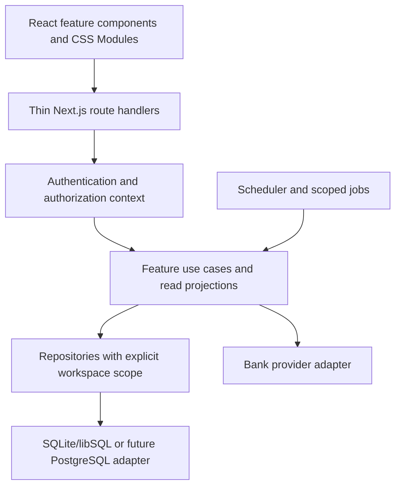
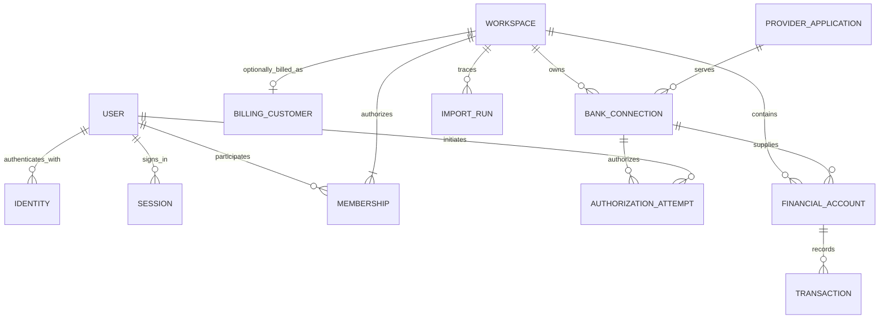

# Architecture: deployment, identity and bank connections

Updated: 2026-11-17. Ufer remains an independent Node.js/TypeScript and React application. The [accepted decision](adr/decisions/001-continue-ufer.md) records the choice over a Sure fork. [Code style](code-style.md) defines the implementation boundaries. This document distinguishes the implemented refactor from the proposed multi-user architecture.

## Current implementation and target

| Area | Implemented now | Target / not implemented |
| --- | --- | --- |
| Application | Next.js modular monolith; explicit routes, feature components/CSS Modules and server use cases/repositories | Tenant-aware request context across every data boundary |
| Identity | Better Auth username/password, revocable sessions, singleton workspace memberships and actor-bound callbacks | Multi-customer scoping, invitations/recovery and OIDC identities |
| Data | SQLite/libSQL; versioned SQL changesets and explicit existing-database maintenance | Tenant schema; PostgreSQL adapter and policies |
| Banking | Operator-configured Enable Banking credentials; sandbox consent and sync | Commercial hosted access and connections across independent customer workspaces |
| Deployment | Docker application plus scheduler; Vercel configuration | Accepted production hosting, multi-user operation and managed-service operations |

The working-tree schema now has individual identities and explicit memberships in one installation workspace. A database constraint prevents creating another workspace while financial repositories remain installation-wide. Environment isolation (`SANDBOX` / `PRODUCTION`) does not isolate customers. The full target ownership schema, SSO flows, PostgreSQL policies and billing relationships below remain unimplemented. Do not expose this version as a shared multi-customer service. The hosted database/login are unchanged until the reviewed authentication migration is approved and applied.

## Application boundaries

The diagram describes the target access boundary; today's HTTP guard verifies a library-managed session and active membership in the singleton installation workspace. Keep one deployable application and an independent scheduler/worker process as needed. Domain logic must not depend on Next.js cookies or React. Database dialects stay behind repositories, and banking protocol details stay behind provider adapters. Introduce abstractions where a real boundary requires them, rather than copying a framework-heavy layered architecture.

Code ownership follows vertical feature slices. UI and server modules for a business feature live under `src/features/<feature>/`, with server-only code in `server/`. The root `src/server/` contains shared database, HTTP, job and security infrastructure only. For example, `features/banking/server/sync-service.ts` coordinates banking repositories and `server/jobs/lease-repository.ts`; it does not live alongside the database driver. Browser imports into either kind of server module are restricted by ESLint. `features/dashboard` composes the persistent shell and the view routes from feature components and owns only the navigation, the load-error banner and the period controls; features, shared components, `src/client` and server modules do not import it, which ESLint also enforces. Server state, URL state, the UI store and the session lock that feature components use directly live in `src/client`; area placeholders and dialog form submission in `src/components/ui`; the reporting period in `src/lib/period.ts`; the cash-flow report in `features/reports`.

The current source uses Better Auth for individual username/password login, persisted sessions and revocation; provider application JWTs use jose. Operator enrollment creates a user, credential and membership atomically. Bank authorization attempts bind the initiating user and authentication session as well as browser/workspace state. See [user management](user-management.md), [security boundaries](security.md) and the [identity decision](adr/decisions/005-username-password-authentication.md). Existing databases require the separately approved authentication migration; multiple independent customers remain disabled.

Dashboard views are page routes in the `(dashboard)` route group under one persistent client layout; the URL holds the view, period and transaction filters. An account's details (`/accounts/<id>`) belong to the accounts section, carry the period like the overview and list that account's transactions page by page. The public `/privacy` and `/terms` pages live outside that group: they render server-side from validated deployment configuration, need no session and load no financial data. A `syncRun` filter on the transactions view lists the transactions a sync run inserted across all months and currencies in place of the period and currency; search, account and category still narrow it, and clearing it returns to the period kept in the URL. Each dashboard area reads its own query through a focused route handler (accounts, an account's balance history and cash flow, net worth, cash flow, transaction list, categories, rules, connections, sync runs, banking status); see the [client state decision](adr/decisions/006-client-server-state.md). The `/api/[...path]/route.ts` fallback returns JSON 404s only. Current endpoints follow Next.js filesystem routing; each resource's route file may export multiple HTTP methods. This is a framework choice, not a requirement for one file per operation. HTTP guards and error mapping are centralized, while account, categorization, import and bank-connection operations have separate server feature modules. The dashboard reads are read projections in the owning features' `server/` modules; they must not become a second write-service collection.

The Drizzle schema describes current persistence tables, and database row/insert types are inferred from it. A single initialized Drizzle instance wraps the application's libSQL client. Account creation, valuations, bank-account mapping, sync/import writes, callback-state consumption and leases use typed Drizzle repositories. Sync and authorization services coordinate these repositories and the provider client; bank-data normalization and transaction categorization are separate from persistence. Shared transaction upserts preserve manual corrections across bank and CSV imports and use bounded statement sizes inside one transaction.

Sync history links each run to the transactions it inserted without a separate column. A sync writes its run's `started_at` (the application clock's `timestamp()`) as `created_at` on the bank rows it inserts; updates keep the original value. For bank rows (`provider_reference` starting with `bank:`), `created_at` therefore means "start of the importing sync run", and a run's transactions are the bank rows of accounts in the run's environment whose `created_at` equals the run's `started_at`. The sync lease serializes runs per environment, and a run whose lease expired keeps stamping its own start. A run's `inserted_count` is derived from these rows when it finishes or is interrupted. Rows stored before this rule carry the database clock and match no run; such runs are shown as not traceable rather than attributed by time window. CSV rows keep the database clock. The rule is defined once in `syncRunTransactions` in the [sync repository](../src/features/banking/server/sync-repository.ts). The dashboard read projection and migration infrastructure retain direct SQL where appropriate, using the same client. There is no separate ORM connection, generic store or compatibility facade. Migration maintenance uses the same client factory in its own explicitly invoked process. Checked-in SQL changesets remain authoritative for database upgrades; changing the TypeScript model alone never changes stored data. API DTOs and future tenant/identity models are separate concerns.

Application modules evolve together against the current state. Previous internal APIs and implementations do not need compatibility layers; update callers and remove obsolete code in the same change. Persisted data evolves through versioned migrations. Supporting mixed application versions requires a separate, explicit requirement. See the [compatibility policy](code-style.md#compatibility-policy).

### Database dialect boundary

Drizzle table definitions describe a physical database dialect: the implemented SQLite/libSQL adapter uses sqliteTable, while PostgreSQL would use pgTable and its own driver and changesets. A generic schema/provider label cannot make defaults, conflict handling, migrations or read-projection SQL portable. The current schema is intentionally honest about the implemented adapter. PostgreSQL can be added behind the repository boundary with a separate dialect schema/migration history, verified query behavior and data migration; it is not prohibited by the product model and is not supported yet. Avoid a speculative universal-provider abstraction before implementing the second adapter. See [Drizzle schema declaration](https://orm.drizzle.team/docs/sql-schema-declaration).

### Transaction types and transfers

Each transaction stores a `type` (income, expense, transfer, opening balance, adjustment) next to its category; the category describes purpose only. The cash-flow read projection counts `income` and `expense` and nothing else, so totals, the spending breakdown and the trend follow the type, never a category flag. Two bookings of one transfer share a `transfer_id`; a unique index allows at most one outgoing and one incoming booking per transfer, and a check constraint allows a `transfer_id` only on transfers. `type_source` and `transfer_source` record manual corrections: the transaction upsert recalculates the type only while it is automatic and unlinked, and automatic pairing skips bookings someone linked or unlinked. The pure pairing rule lives in `features/transactions/server/transfer-pairing.ts`; the [transfer repository](../src/features/transactions/server/transfer-repository.ts) reads candidates and saves a booking's type together with its transfer target (a suggested booking, a manual account on which the counterpart is created, or none) in one transaction. Sync pairs once after storing every account; CSV import and the demo seed pair inside their write transaction. See [ADR 008](adr/decisions/008-transaction-types-and-transfers.md).

### Client request lifecycle

TanStack Query owns server state in the browser ([ADR 006](adr/decisions/006-client-server-state.md)). Query keys start with the resource and end with the URL-derived filters that select it, so responses for earlier filters can never replace those for the current ones and a write invalidates a resource by prefix. The dashboard layout resolves the session on the server, so a signed-out request renders the sign-in form and a signed-in one the shell with the first response; the shell does not wait for any query. Every view lays out all of its areas at once: until an area's first results arrive it shows a skeleton in the shape of its content, hidden from assistive technology behind one polite status announcement, and a failed first load replaces the skeleton with the reason and a Retry for that area. Filter-keyed areas keep their previous results as placeholders: values and labels pulse after 250 ms, larger areas fade and become inert, and a failed request ends loading behind a static placeholder with a Retry banner that stays until a load succeeds. Data older than 30 seconds is refetched in the background when a view mounts or the window regains focus. Every write is a mutation whose pending and error state belong only to its own control; there is no dashboard-wide busy state. Changes to one transaction's category are serialized with a mutation scope that outlives the views. Any read or write rejected with 401, except a sign-in attempt, clears the query and mutation caches and shows the sign-in form; a late response cannot restore financial data. Outside TanStack Query, components read the URL through typed hooks per parameter and change it through plain setter functions; page-level feedback, the session lock and the period remembered for views without one live in a small Zustand store read through selectors, a dialog's open state and data stay with the component that opens it, and field drafts stay in their forms ([ADR 007](adr/decisions/007-client-ui-and-url-state.md)). This is a client privacy/freshness boundary; the server still authorizes every request independently. [Lifecycle](../tests/dashboard-lifecycle.test.ts), [categorization](../tests/transaction-categorization.test.ts) and [independent action](../tests/independent-actions.test.ts) tests exercise these rules.

## People, workspaces and customers

A person, a financial data boundary and a billing relationship are different concepts.

| Entity | Purpose and key constraints |
| --- | --- |
| `User` | A person with an opaque internal ID and lifecycle status; email/display name are attributes, not ownership keys |
| `Identity` | Links a user to a verified issuer and subject; unique `(issuer, subject)`; credentials and identity-provider metadata are not financial accounts |
| `Workspace` | Tenant boundary for financial data; represents one personal or household finance space |
| `Membership` | Unique `(workspace_id, user_id)` with role and status; authorization requires an active membership |
| `Session` | Revocable server-side session tied to a user; an active workspace is a validated selection, not a trusted arbitrary cookie/body field |

`BillingCustomer` is an optional hosted-only relationship, one per workspace, holding billing-provider references and subscription state. Paying for a workspace does not grant access to financial data without membership. Self-hosting needs no billing record. A user may have memberships in more than one workspace; a workspace selector is a future UI decision, not permission to merge financial data.

Local password authentication additionally needs a user-bound credential record managed by the chosen authentication library. Invitations and recovery tokens are short-lived, one-time records stored as hashes; they never substitute for an active membership. OIDC provider configuration has an explicit trusted issuer/client configuration and optional workspace policy. Invitations, recovery and OIDC details remain proposed; local password identities are implemented under the constrained installation model.

The ER diagram shows logical ownership, not executable migration DDL. A workspace's first owner must be created atomically with the workspace. Do not remove or disable the last owner without an explicit ownership transfer/recovery process.

### Roles and permission boundaries

| Role | Intended permissions |
| --- | --- |
| Owner | Financial management, membership/ownership management and workspace lifecycle |
| Admin | Financial management and bank connections; no implicit ownership transfer or permanent workspace deletion |
| Member | Read financial data and perform authorized bookkeeping; provider connection management requires an explicit capability |
| Viewer | Read-only financial access; no mutation, import publishing, bank authorization or sync management |
| Deployment operator | Configure infrastructure/provider applications; platform administration is separate from workspace membership and any audited support access |

Exact membership-invitation and member-editing capabilities require product acceptance before implementation. Billing permissions are explicit rather than inferred from a bank login. Keep the initial permission set small; add account-level sharing only when its use cases and report semantics are defined.

## Self-hosted and hosted operation

| Concern | Self-hosted target | Hosted target |
| --- | --- | --- |
| First use | One default workspace and an individually authenticated owner; single-use bootstrap enrollment | Individual signup/login creates or joins an authorized workspace |
| Additional people | Explicit invitations/memberships; no shared identity required | Same membership model and authorization rules |
| Identity provider | Local authentication or operator-configured OIDC, for example a household's IdP | Managed login; OIDC identities; external organization SSO can be added later |
| Bank credentials | Operator configures an authorized provider application, or optionally uses a future managed connector | Ufer operator manages commercial provider applications; users never configure application keys |
| Storage | SQLite/libSQL initially; existing database/volume paths remain intact | PostgreSQL is a planned option; not yet implemented or selected as a launch requirement |

Both modes use the same domain and authorization model. A single-workspace installation may simplify navigation, not bypass ownership checks. The current source implements individual username/password users through Better Auth for the singleton installation workspace. The hosted deployment still needs the approved cutover. Extend the maintained identity library for future recovery, invitations and OIDC rather than introducing custom credential protocols.

## Operator applications, consent and financial accounts

| Entity | Ownership / role |
| --- | --- |
| `ProviderApplication` | Operator-managed provider/environment configuration with a secret reference, callback policy and lifecycle; no customer-editable private key fields |
| `BankConnection` | Workspace-owned institution connection referencing an allowed provider application; consenting-user reference, encrypted provider session, consent expiry, status and credential-version linkage |
| `AuthorizationAttempt` | Short-lived, one-time flow bound to initiating user, authenticated session, workspace and intended connection/reconnect target; stores state hash and provider-specific verification material |
| `FinancialAccount` | Workspace-owned account; optional bank connection for synced accounts; preserves institution/provider identities without using them as authorization |
| `ImportRun` | Workspace/account-scoped sync or file-import execution with status, times and traceable outcomes |

A provider application can serve multiple independent consent sessions. A customer cannot select arbitrary platform credentials or read secrets through API responses, exports or logs. Store secret references and version metadata separately from user consent; secret rotation must not require copying keys into every customer connection.

The normal journey is **Connect bank → choose bank → provider/bank consent → verified callback → initial sync**. Reconnect targets an existing connection and preserves financial-account identity; it must not create duplicate accounts/history. Denial, expiry, repeated callbacks, lost browser state and bank-app return need explicit recovery behavior. Removing a connection revokes supported upstream access and schedules credential removal; historical records follow the user's explicit retention/deletion choice.

Removing the consenting user requires an explicit policy for revoking or reauthorizing that connection; workspace ownership alone must not silently extend a departed person's bank consent. Record this actor separately from the financial account owner.

SSO login and bank consent are separate protocols and permissions. A successful login never authorizes bank-data access on its own, and a successful bank callback never authenticates a new Ufer user. PKCE and other checks are applied where the chosen protocol supports/requires them; do not assume that all bank APIs are interchangeable OAuth implementations.

### Data-access invariants

1. Resolve the authenticated user and active membership server-side for each request. Client-provided workspace/account IDs are selectors to authorize, never proof of access. Revoked membership must stop access without waiting for a long-lived browser token to expire.
2. Require a validated `WorkspaceContext` at repository/use-case entry points. Financial tables, categories, rules, snapshots, import runs and bank attempts carry `workspace_id`; global identity/billing/provider configuration has a distinct access path.
3. Use composite relationships such as `(workspace_id, account_id)` and `(workspace_id, category_id)` to reject cross-workspace links. Scope external-ID uniqueness to the owning workspace/account and provider environment. The same institution identification hash in different workspaces must never merge or rebind their accounts.
4. Queue jobs with workspace, resource and actor/service identity. Revalidate resource ownership and required permissions on execution. Include workspace scope in leases, cache keys, exports, object-storage paths and audit events.
5. Check the same rules on reads, writes, bulk operations, reports and callbacks. Use tests with at least two workspaces, swapped identifiers, revoked memberships and retried jobs; scope violations fail closed.

SQLite provides no equivalent to PostgreSQL row-security policies; application scoping and relational constraints remain mandatory. If the PostgreSQL adapter is implemented, evaluate RLS as an additional boundary, using a non-bypassing runtime role and transaction-local scope. Pool reuse must not carry another workspace's context. RLS is not implemented today. See [PostgreSQL row security](https://www.postgresql.org/docs/current/ddl-rowsecurity.html) and [OWASP tenant isolation guidance](https://cheatsheetseries.owasp.org/cheatsheets/Multi_Tenant_Security_Cheat_Sheet.html).

## SSO-ready identity boundary

Use a maintained OIDC client/authentication library and the authorization-code flow with PKCE, state and nonce validation as applicable. Validate issuer, audience, token signature and expiration. Identity linking is an authenticated, explicit action; never merge accounts or grant workspace membership solely because two providers report the same email/domain. Invitations and configured membership policies are separate from successful identity-provider login.

Represent identities independently of the financial schema so a local user can later link SSO without reassigning accounts. Provider configuration, allowed issuers, signup policy, session revocation and recovery need explicit operational ownership. If SAML becomes necessary, evaluate a broker to the OIDC boundary before adding another protocol to the finance application. No SSO provider/library or managed identity service is selected yet. [OpenID Connect specification](https://openid.net/specs/openid-connect-core-1_0.html).

## Migration and implementation sequence

1. Keep the current single-workspace application working; use the reviewed [migration workflow](database-migrations.md) and preserve paths, volumes, IDs and financial data.
2. Review the proposed identity/workspace model and choose the authentication library. Specify hosted signup and self-hosted owner enrollment/recovery before changing the schema.
3. Prepare explicit changesets/backfill: create the default workspace, associate all existing financial rows and connections, link the chosen owner identity, and validate counts, balances and foreign keys on a disposable copy. Never infer the owner from banking data.
4. Enforce scoped repositories, request/callback context and worker checks; complete cross-workspace security tests. Switch the legacy session only with an approved migration/recovery plan.
5. Accept hosted provider access, operations, backups/restore and real-mobile bank flows before onboarding independent customers. Billing and additional database adapters do not substitute for those checks.

No tenant backfill, data reassignment, destructive operation, user enrollment or SSO configuration is performed as part of this architecture document. The [proposed ADR](adr/decisions/XXX-workspaces-identity-and-banking.md) is ready for review.
