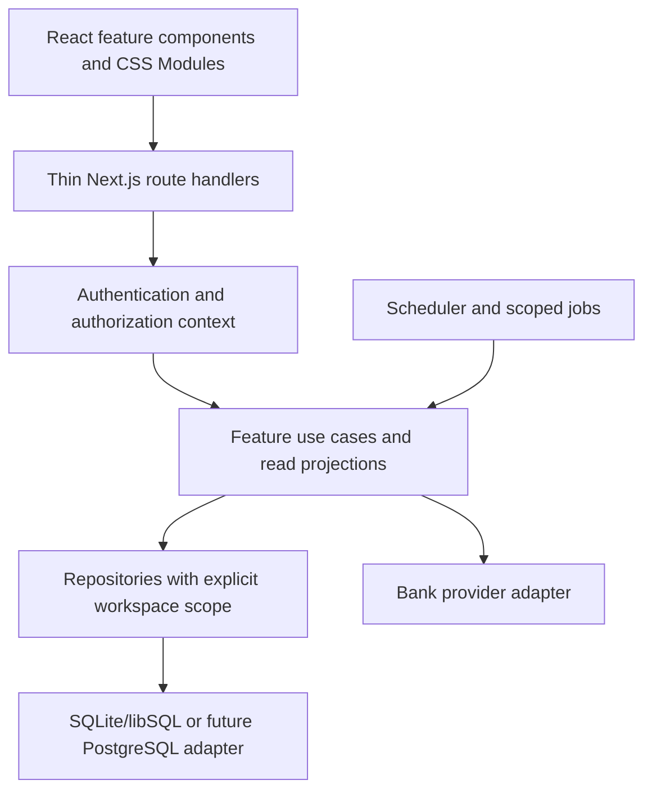

# Architecture: deployment, identity and bank connections

Ufer remains an independent Node.js/TypeScript and React application. The [accepted decision](adr/decisions/001-continue-ufer.md) records the choice over a Sure fork. [Code style](code-style.md) defines the implementation boundaries. This document distinguishes the implemented application from the proposed multi-customer architecture.

## Current implementation and target

| Area | Implemented now | Target / not implemented |
| --- | --- | --- |
| Application | Next.js modular monolith; explicit routes, feature components/CSS Modules and server use cases/repositories | Tenant-aware request context across every data boundary |
| Identity | Better Auth username/password, revocable sessions, singleton workspace memberships and actor-bound callbacks | Multi-customer scoping, invitations/recovery and OIDC identities |
| Data | SQLite/libSQL; versioned SQL changesets and explicit existing-database maintenance | Tenant schema; PostgreSQL adapter and policies |
| Banking | Operator-configured Enable Banking credentials; sandbox and restricted production consent and sync | Commercial hosted access and connections across independent customer workspaces |
| Deployment | Docker application plus scheduler; Vercel production deployment | Multi-customer operation and managed-service operations |

The schema has individual identities and explicit memberships in one installation workspace. A database constraint prevents creating another workspace while financial repositories remain installation-wide. Each database serves exactly one banking environment (`SANDBOX` or `PRODUCTION`), set by `ENABLE_BANKING_ENVIRONMENT`; rows carry no environment, and this separation does not isolate customers. The full target ownership schema, SSO flows, PostgreSQL policies and billing relationships below remain unimplemented. Do not expose this version as a shared multi-customer service.

## Application boundaries

The diagram describes the target access boundary; today's HTTP guard verifies a library-managed session and active membership in the singleton installation workspace. Keep one deployable application and an independent scheduler/worker process as needed. Domain logic must not depend on Next.js cookies or React. Database dialects stay behind repositories, and banking protocol details stay behind provider adapters. Introduce abstractions where a real boundary requires them, rather than copying a framework-heavy layered architecture.

Code ownership follows vertical feature slices. UI and server modules for a business feature live under `src/features/<feature>/`, with server-only code in `server/`. The root `src/server/` contains shared database, HTTP, job and security infrastructure only. For example, `features/banking/server/sync-service.ts` coordinates banking repositories and `server/jobs/lease-repository.ts`; it does not live alongside the database driver. Browser imports into either kind of server module are restricted by ESLint. `features/dashboard` composes the persistent shell and the view routes from feature components and owns only the navigation, the load-error banner and the period controls; features, shared components, `src/client` and server modules do not import it, which ESLint also enforces. Server state, URL state, the UI store and the session lock that feature components use directly live in `src/client`; area placeholders and dialog form submission in `src/components/ui`; the reporting period in `src/lib/period.ts`; the cash-flow report in `features/reports`.

Ufer uses Better Auth for individual username/password login, persisted sessions and revocation; provider application JWTs use jose. Operator enrollment creates a user, credential and membership atomically. Bank authorization attempts bind the initiating user and authentication session as well as browser/workspace state. See [user management](user-management.md), [security boundaries](security.md) and the [identity decision](adr/decisions/005-username-password-authentication.md). Multiple independent customers remain disabled.

Dashboard views are page routes in the `(dashboard)` route group under one persistent client layout; the URL holds the view, period and transaction filters. The overview has no period of its own: it shows the current month and the twelve months up to it, and keeps the period selected elsewhere only for the views it links to. An account's details (`/accounts/<id>`) belong to the accounts section, carry the period like the transactions view and list that account's transactions page by page. The public `/privacy` and `/terms` pages live outside that group: they render server-side from validated deployment configuration, need no session and load no financial data. A `syncRun` filter on the transactions view lists the transactions a sync run inserted across all months and currencies in place of the period and currency; search, account and category still narrow it, and clearing it returns to the period kept in the URL. Each dashboard area reads its own query through a focused route handler (accounts, an account's balance history and cash flow, net worth, cash flow, transaction list, categories, rules, connections, sync runs, banking status); see the [client state decision](adr/decisions/006-client-server-state.md). The `/api/[...path]/route.ts` fallback returns JSON 404s only. Current endpoints follow Next.js filesystem routing; each resource's route file may export multiple HTTP methods. This is a framework choice, not a requirement for one file per operation. HTTP guards and error mapping are centralized, while account, categorization, import and bank-connection operations have separate server feature modules. The dashboard reads are read projections in the owning features' `server/` modules; they must not become a second write-service collection.

The Drizzle schema describes current persistence tables, and database row/insert types are inferred from it. A single initialized Drizzle instance wraps the application's libSQL client. Account creation, valuations, bank-account mapping, sync/import writes, callback-state consumption and leases use typed Drizzle repositories. Sync and authorization services coordinate these repositories and the provider client; bank-data normalization and transaction categorization are separate from persistence. Shared transaction upserts preserve manual corrections across bank and CSV imports and use bounded statement sizes inside one transaction.

Sync history links each run to the transactions it inserted without a separate column. A sync writes its run's `started_at` (the application clock's `timestamp()`) as `created_at` on the bank rows it inserts; updates keep the original value. For bank rows (`provider_reference` starting with `bank:`), `created_at` therefore means "start of the importing sync run", and a run's transactions are the bank rows whose `created_at` equals the run's `started_at`. The sync lease serializes runs, and a run whose lease expired keeps stamping its own start. A run's `inserted_count` is derived from these rows when it finishes or is interrupted. Rows stored before this rule carry the database clock and match no run; such runs are shown as not traceable rather than attributed by time window. CSV rows keep the database clock. The rule is defined once in `syncRunTransactions` in the [sync repository](../src/features/banking/server/sync-repository.ts). The dashboard read projection and migration infrastructure retain direct SQL where appropriate, using the same client. There is no separate ORM connection, generic store or compatibility facade. Migration maintenance uses the same client factory in its own explicitly invoked process. Checked-in SQL changesets remain authoritative for database upgrades; changing the TypeScript model alone never changes stored data. API DTOs and future tenant/identity models are separate concerns.

Application modules evolve together against the current state. Previous internal APIs and implementations do not need compatibility layers; update callers and remove obsolete code in the same change. Persisted data evolves through versioned migrations. Supporting mixed application versions requires a separate, explicit requirement. See the [compatibility policy](code-style.md#compatibility-policy).

### Database dialect boundary

Drizzle table definitions describe a physical database dialect: the implemented SQLite/libSQL adapter uses sqliteTable, while PostgreSQL would use pgTable and its own driver and changesets. A generic schema/provider label cannot make defaults, conflict handling, migrations or read-projection SQL portable. The current schema is intentionally honest about the implemented adapter. PostgreSQL can be added behind the repository boundary with a separate dialect schema/migration history, verified query behavior and data migration; it is not prohibited by the product model and is not supported yet. Avoid a speculative universal-provider abstraction before implementing the second adapter. See [Drizzle schema declaration](https://orm.drizzle.team/docs/sql-schema-declaration).

### Transaction types and transfers

Each transaction stores a `type` next to its category, and the cash-flow read projection counts only `income` and `expense`. The two bookings of a transfer share a `transfer_id`; a unique index allows one outgoing and one incoming booking per transfer, and a check constraint allows a `transfer_id` only on transfers. `type_source`, `transfer_source` and `type_rule_id` record manual corrections and rule decisions. The pure pairing rule lives in `features/transactions/server/transfer-pairing.ts`; [transfer rules](../src/features/transactions/server/transfer-rules.ts) hold the SQL predicates, [transfer subjects](../src/features/transactions/server/transfer-subjects.ts) read candidates, and the [type change](../src/features/transactions/server/transaction-type-change.ts) carries out the pure [type-change decision](../src/features/transactions/server/type-change-decision.ts), saving a booking's type together with its transfer target in one transaction. Sync pairs once after storing every account; CSV import and the demo seed pair inside their write transaction. [ADR 008](adr/decisions/008-transaction-types-and-transfers.md) defines detection, pairing and rule-set types; [banking](banking.md#data-transfers-and-rules) describes them for users.

Rules are stored with distinct priorities and matched by priority, then ID; [banking](banking.md#data-transfers-and-rules) describes matching for users. At most 1,000 rules exist; every rule insert checks the limit in its write transaction and answers 409 beyond it. Reordering (dnd-kit pointer and keyboard sensors) stores the new order through `features/categorization/rule-order.ts` in one write transaction that only succeeds when it lists exactly the stored rules. Deleting a category moves or clears its transactions and rules in one transaction and keeps `category_source`, including on hidden bookings and archived accounts. No application logic depends on a particular category, so none is protected from deletion.

Every account's balance is the sum of its visible transactions, read in the account list; `balance_snapshots` keep the balances banks report for comparison, and `accounts.balance_minor` is unused ([ADR 010](adr/decisions/010-bank-account-balances-from-transactions.md)). The [opening balance repository](../src/features/transactions/server/opening-balance-repository.ts) books a bank-linked account's opening balance on its first sync and moves it before older synced or imported bookings. The [manual transaction repository](../src/features/transactions/server/manual-transaction-repository.ts) enters, edits and deletes bookings entered in Ufer (`manual:` references and created counterparts on manual accounts) and records a balance for a date as an opening balance or an adjustment for the difference; account creation, the balance edit button beside a manual account's balance and the demo seed share that rule. Archiving sets `accounts.archived_at` and needs a balance of exactly 0 (otherwise 409). The archive dialog closes a manual account with a remaining balance first: in one transaction it books the balance away on an editable date as an adjustment or as a transfer to another active manual account in the same currency, then archives it. A bank-linked balance follows its bank bookings and cannot be booked away, so such an account is archived only once its bookings bring the balance to 0; archived accounts are hidden from the account lists, overview and pickers by the client, still count in net worth and cash-flow reports, offer no manual balance or transaction entry and are skipped by bank sync until restored; archiving freezes their bookings' amounts, dates, entries and visibility; categories, splits, payee and description overrides and rule application stay available, and imported bookings can be linked with or unlinked from existing imported bookings, but no counterpart is created or removed; the next sync then fetches what they missed within the provider's transaction window. When both sides of a transfer were entered in Ufer, the transfer repository treats them as one movement that either side edits, moves or removes. See [ADR 009](adr/decisions/009-manual-account-balances-from-transactions.md).

### Securities

[ADR 012](adr/decisions/012-brokerage-holdings-and-valuations.md) values brokerage accounts from security trades and daily prices; it is implemented in parts. Implemented so far: changeset 0022 adds the `brokerage` account kind, the `buy`/`sell` transaction types and the `securities`, `security_prices`, `security_splits` and `security_trades` tables, and the pure [holdings calculations](../src/features/securities/holdings.ts) replay trades and splits into a quantity, moving-average cost and realized gain and value a quantity with the latest price on or before a date. The [security service](../src/features/securities/server/security-service.ts) creates securities and brokerage accounts and records and deletes trades under the sync lease: a trade on a manual settlement account books its cash side as a `buy`/`sell` entry, one on a bank-linked account marks an existing bank booking of the exact cash amount (pure [trade decisions](../src/features/securities/trade-decisions.ts)), and every change replays the security's trades so no sale exceeds the quantity held. [Trade-leg rules](../src/features/transactions/server/trade-leg-rules.ts) keep a cash side out of booking edits, hiding and transfer linking, and `bookableAccount` in [booking accounts](../src/features/transactions/server/booking-accounts.ts) keeps brokerage accounts out of manual bookings, transfers, imports and bank connections. Routes: `/api/securities`, `/api/brokerage-accounts`, `/api/brokerage-accounts/[id]/trades`, `/api/brokerage-accounts/[id]/settlement-candidates` and `/api/trades/[id]`. A brokerage account's balance in the account list is the value of its holdings today from the pure [valuation](../src/features/securities/valuation.ts) over trades, splits and stored prices ([valuation repository](../src/features/securities/server/valuation-repository.ts)); a holding without a price on or before the date counts zero and is reported missing, one with a price more than 7 days old is reported stale (`valuation` on the account, `incompleteValuations` on net worth). Its balance history is the value on every trade, split and price date, so net worth and its history include holdings at each month's own prices. While a trade's bank booking lies on another day than the trade, the history also counts the cash moved on only one side, so settlement cash plus holdings stay unchanged by the trade; today's balance needs no offset because current balances include every visible booking. The daily cron run updates prices after the bank sync, under its own `market-data` lease ([price update service](../src/features/securities/server/price-update-service.ts)): each security with a provider symbol gets the closes it is missing, plus the last three stored days for provider corrections, from the [EODHD provider](../src/features/securities/server/market-data/eodhd-provider.ts), splits once a week within the provider's one-year history (an older first trade stays flagged because earlier splits cannot be checked), and its last attempt and error stored on the security. Without `MARKET_DATA_API_KEY` the update does nothing and `GET /api/securities` reports no price source; `GET /api/securities/listings?isin=` searches listings. Screens follow in a later part.

### Tab-bar history

At phone widths the sidebar is a bottom tab bar, and its links navigate like native app tabs ([use-tab-navigation](../src/client/use-tab-navigation.ts)). A tab tap goes back through the Navigation API to the oldest entry of the current app document, then replaces it with the tab's page, so a tab switch writes no entry and Back from a tab root leaves the app (in the installed PWA, the Android back gesture closes it) or returns to the page before Ufer. Navigation inside a tab, such as an account's details, still pushes entries, and tapping the active tab returns to its root. Wider layouts keep ordinary link history, and modifier clicks keep their browser behavior.

Browsers cannot delete history: forward entries remain until the next navigation inside the app, and a full page load (such as signing in) starts a new document whose first entry becomes the root, so Back from there returns to the earlier page. Browsers without the Navigation API only replace the current entry. Per-tab stacks that restore a tab's last location are not implemented: rebuilding several entries needs a chain of navigations that the back gesture can interrupt.

### Client request lifecycle

TanStack Query owns server state in the browser ([ADR 006](adr/decisions/006-client-server-state.md)). Query keys start with the resource and end with the URL-derived filters that select it, so responses for earlier filters can never replace those for the current ones and a write invalidates a resource by prefix. The dashboard layout resolves the session on the server, so a signed-out request renders the sign-in form and a signed-in one the shell with the first response; the shell does not wait for any query. Every view lays out all of its areas at once: until an area's first results arrive it shows a skeleton in the shape of its content, hidden from assistive technology behind one polite status announcement, and a failed first load replaces the skeleton with the reason and a Retry for that area. Filter-keyed areas keep their previous results as placeholders: values and labels pulse after 250 ms, larger areas fade and become inert, and a failed request ends loading behind a static placeholder with a Retry banner that stays until a load succeeds. Data older than 30 seconds is refetched in the background when a view mounts or the window regains focus. Every write is a mutation whose pending and error state belong only to its own control; there is no dashboard-wide busy state. Changes to one transaction's category are serialized with a mutation scope that outlives the views. Any read or write rejected with 401, except a sign-in attempt, clears the query and mutation caches and shows the sign-in form; a late response cannot restore financial data. Outside TanStack Query, components read the URL through typed hooks per parameter and change it through plain setter functions; page-level feedback, the session lock and the period remembered for views without one live in a small Zustand store read through selectors, a dialog's open state and data stay with the component that opens it, and field drafts stay in their forms ([ADR 007](adr/decisions/007-client-ui-and-url-state.md)). This is a client privacy/freshness boundary; the server still authorizes every request independently. [Lifecycle](../tests/dashboard-lifecycle.test.ts), [categorization](../tests/transaction-categorization.test.ts) and [independent action](../tests/independent-actions.test.ts) tests exercise these rules.

## Target multi-customer design

The proposed people/workspace/customer model, hosted and self-hosted operation, provider-application ownership, data-access invariants, SSO-ready identity boundary and remaining implementation sequence are described in the [target architecture](architecture-target.md).
